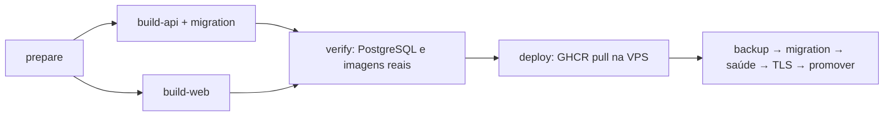

# Relatório Final de Otimização

## Resumo
Implementação concluída no repositório; deploy e testes de imagens ainda pendentes. Protocolo aplicado à infraestrutura, runtime, código consultado, banco, persistência, logs, backup, build e CI/CD. A VPS foi consultada somente para leituras. Nenhum dado, container, imagem, serviço vizinho ou configuração de produção foi modificado.

## Antes
Vox não estava implantado. Baseline do host compartilhado em 09/10/2026, 15:13 BRT: 15988 MiB RAM, 4948 usados/10267 disponíveis; swap 501 MiB usados; 4 CPUs; disco 51/194 GiB usados; 55 containers ativos de outras aplicações. Imagens Docker: 38.28 GB lógicos (não espaço fisicamente recuperável). Não é possível comparar RAM de Vox antes/depois.

Arquitetura declarada anterior: PostgreSQL, Express, frontend Node serve e Nginx container; Nginx/TLS no host. Pipeline copiava repositório inteiro, instalava infraestrutura no host, fazia build --no-cache na VPS, parava o Compose, executava migrations duas vezes, seed destrutivo e prune global.

## Alterações realizadas
- Um único workflow com prepare, build-api, build-web, verify e deploy. API e web dependem somente de prepare e executam em paralelo. API produz runtime e imagem temporária de migration usando cache compartilhado do mesmo build.
- npm ci com lockfile e contexto filtrado por .dockerignore; dependências de desenvolvimento removidas do runtime API. CLI Prisma e ferramentas ficam na imagem temporária.
- Nginx serve SPA e proxy de API/uploads no mesmo container. DNS Docker dinâmico evita ficar preso ao IP de uma API substituída. Cache somente em assets versionados; HTML revalidado; gzip moderado.
- Pool PostgreSQL explícito de 5 conexões por processo de API; database max_connections=30, shared_buffers=128MB e work_mem=4MB. Dashboard usa agregações no banco e mantém formato/valores da resposta.
- 10 índices aditivos para filtros de tenant/data e relações realmente consultadas. Nenhuma tabela/coluna/dado removido.
- Readiness consulta o banco, liveness continua disponível. SIGTERM/SIGINT fecha HTTP, desconecta Prisma e possui timeout. API executa como node, sem capabilities e sem elevação de privilégios.
- Modal remonta estado por produto, elimina effect que provocava render adicional e cancela timer ao desmontar. Hook/contexto e guardas de rota separados para preservar Fast Refresh. Resgate apresenta somente código real recebido do backend.

## Serviços removidos
O container proxy separado foi consolidado no frontend Nginx. O processo Node serve foi substituído por arquivos estáticos. Nenhum serviço que mantém dados foi removido. Migration aparece no perfil tools e só executa sob demanda.

## Docker e imagens
Runtime da API contém dependências de produção, cliente/engine Prisma gerado, JavaScript compilado e OpenSSL; não executa npx nem migration ao subir. Frontend final contém Nginx e dist, sem Node. Imagem de migration mantém CLI/engines e bootstrap compilado para evitar downloads na VPS. Tamanhos reais das imagens: NOT_MEASURED; Docker Linux indisponível localmente.

## RAM e CPU
Limites iniciais ajustáveis em .env: API 768 MiB/1 CPU, banco 512 MiB/1 CPU, web 64 MiB/0.5 CPU; migration temporária 512 MiB/1 CPU. Limites de PIDs também configurados. Limites não são métricas de consumo nem reservas garantidas. Nenhum heap arbitrário ou alteração de kernel/swap aplicada. Pool configurado reduz a dependência do tamanho do host, mas concorrência/latência precisam de carga real.

## Banco
Dashboard não transfere mais todas as linhas do mês e de ontem para somar no Node. Consultas de listas existentes mantêm contratos; paginação de pedidos/clientes/produtos exige adaptar consumidores e permanece risco de crescimento. Não foi introduzido cache para encobrir queries. Prisma validate passou; diff do schema mostrou exclusivamente os mesmos 10 CREATE INDEX da migration adicionada. Aplicação efetiva das migrations e planos EXPLAIN: NOT_MEASURED.

## Storage e disco
Preservados os nomes voxcelular_pgdata e voxcelular_uploads. Logs JSON têm rotação 10 MiB × 3 por container (aproximadamente 90 MiB por três residentes, excluindo margem de rotação e jobs temporários). Release recebe somente Compose, manifest de imagens e scripts; não recebe source, node_modules ou build cache. Sem prune, remoção de volumes ou retenção destrutiva automática.

Antes da migration, deploy produz pg_dump -Fc, valida o catálogo com pg_restore --list e arquiva uploads por mount somente leitura. Banco/volume existente sem .env bloqueia o deploy para preservar credenciais originais. Backups ficam em /opt/voxcelular/backups/<release> com permissões restritas. Backup no mesmo disco não protege contra perda da VPS; cópia externa é pendência operacional. Dump e uploads têm instantes distintos durante escrita ativa: workloads que exijam snapshot conjunto precisam de janela de manutenção ou backup coordenado.

## Build e deploy

GHCR publica com GITHUB_TOKEN do job; deploy usa referências por digest e credencial temporária via stdin, descartada ao terminar. Pacotes precisam estar associados ao repositório para herdar permissões, conforme a [documentação do GitHub](https://docs.github.com/en/packages/working-with-a-github-packages-registry/working-with-the-container-registry). Nenhum PAT permanente novo é necessário para pacotes deste repositório.

SSH usa root@72.60.10.108 e o secret VPS_PASSWORD já previsto no workflow, sem ler ou exibir seu conteúdo. Chave local dedicada continua apenas no PC. A chave pública de host conhecida foi fixada em .github/ssh_known_hosts e StrictHostKeyChecking=yes; reinstalação futura com mudança de chave exige conferir identidade e atualizar esse arquivo. Login por senha não foi alterado.

Porta 3096 é de makucho-nginx; novo binding é 127.0.0.1:3196. Preflight recusa listeners de outra aplicação e containers sem ownership esperado. Nginx altera apenas o virtual host Vox, preserva outros sites e reverte seu próprio arquivo em caso de falha. TLS mantém ACME e verifica HTTPS local com nome de servidor correto. Docker/Compose/Nginx/Certbot já existem no host; não há instalação ou reconfiguração global no deploy.

O symlink current só muda depois de containers, banco, SPA e HTTPS passarem. Em falha posterior à migration, release anterior retorna somente imagens de API/web; banco não é revertido automaticamente. Isso é compatível com os índices aditivos atuais. Migrations destrutivas futuras precisam de estratégia de compatibilidade própria. No primeiro deploy não existe release anterior: dados permanecem para diagnóstico.

## Jobs e processos
Nenhum worker, fila, cron, Redis ou browser headless encontrado na stack implantável. Timers do frontend são do navegador. Migration deixa de ser uma tarefa de startup permanente. Builds não disputarão CPU/RAM do host com aplicações residentes. Pulls na VPS são sequenciais para reduzir pressão de decompression/I/O.

## Depois
Reconsulta do host às 15:27 BRT: RAM 4953 MiB usados/10263 disponíveis; swap 501 MiB usados; disco 51/194 GiB; load 0.66/0.98/1.30. Vox continua sem containers/volumes próprios e porta 3196 livre. Variação do host pertence às aplicações vizinhas e não demonstra ganho de Vox.

## Comparação
| Item | Antes | Depois | Evidência |
|---|---|---|---|
| Workflows | 1 | 1, jobs separados | Configuração validada |
| Builds na VPS | 2 aplicativos, sem cache | 0 | Compose sem build; scripts --no-build |
| Builds GitHub | Nenhum | API/web paralelos, cache | Grafo validado; execução pendente |
| Containers permanentes Vox | 4 declarados | 3 declarados | Compose validado; não implantado |
| Node para frontend | 1 processo residente | 0 | Dockerfile final Nginx |
| Migration por deploy | Startup + deploy | 1 | Código; aplicação no CI pendente |
| Dashboard somatórios | Lista proporcional ao dataset | Agregações de tamanho constante | Código/build; banco real pendente |
| Pool API | Padrão Prisma | 5 configuradas | Configuração, não conexões medidas |
| Logs | Sem limite explícito | 10 MiB × 3 por container | Configuração validada |
| RAM/CPU/pico/latência Vox | NOT_MEASURED | NOT_MEASURED | Aplicação ausente; não inventar ganhos |
| Disco/tamanho imagens Vox | NOT_MEASURED | NOT_MEASURED | Sem Docker Linux local |

## Testes
PASS nesta sessão:
- npm ci com lock sem mudanças no package-lock.
- Reprodução isolada das etapas npm ci/generate/build/prune da API: cliente Prisma preservado e CLI removido após prune. Teste Windows, sem substituir verificação dos engines Alpine no CI.
- Prisma generate, Prisma validate, build/typecheck da API.
- Lint frontend: quatro falhas anteriores corrigidas, agora passa sem desabilitar regras.
- Build frontend Vite; resultado final aproximadamente 447 kB JS, 124 kB gzip (não ganho material de bundle).
- YAML parse com chaves únicas, Compose config e checagem do grafo de jobs.
- actionlint 1.7.7, incluindo ShellCheck para blocos de workflow; ShellCheck 0.10.0 em nível warning para scripts; bash -n.
- API local: liveness 200; readiness 503 quando banco está inacessível; dashboard sem token 401. Isto não equivale a teste com banco disponível.
- Prisma migrate diff offline: somente 10 índices aditivos; sem remoção de dados/schema.
- git diff --check.

PENDENTE, implementado no job verify e obrigatório antes de deploy:
- Build das imagens Linux, engines Prisma, runtime sem CLI, configurações Nginx.
- Migration em PostgreSQL real e reaplicação idempotente.
- Bootstrap repetido sem alterar loja existente; login/admin e restrição de cliente.
- Upload/download, SPA e 404 de asset ausente.
- Dashboard com 2000 pedidos e 12 requisições concorrentes; métricas de tempo/RAM/CPU e pool.
- Persistência após recriar API, recuperação de DNS, ausência de OOM.
- Dump binário e restore em banco descartável com verificação dos 2000 pedidos.

Tests usam dados e serviços reais em runner descartável, sem mocks. Remoção de volumes ocorre exclusivamente no cleanup do runner CI; esse teste/cleanup não é enviado nem executado na VPS.

## Ações que exigem autorização
Nenhuma limpeza destrutiva executada ou agendada. Mudanças do host/Vox só serão feitas pelo GitHub Actions ao executar este workflow. Recursos vizinhos permanecem fora do escopo. Restore em produção, remoção de backups/imagens e mudanças incompatíveis de schema exigem revisão explícita.

## Bloqueios

DNS consultado na VPS: voxcelular.com.br e www.voxcelular.com.br resolvem para 72.60.10.108. Certbot, Nginx e timer de renovação existem; emissão efetiva do certificado continua pendente do workflow.
Docker Desktop não inicia: log registra “Virtual Machine Platform not enabled”. Não foi habilitada infraestrutura de Windows nem reiniciado o computador. Builds/testes de containers ficam NOT_MEASURED até o workflow rodar ou haver Docker Linux local funcional. Não houve commit, push ou execução externa de workflow nesta sessão; não declarar deploy concluído.

## Riscos restantes
Limites são iniciais e precisam de carga real/dataset representativo. O host hospeda muitas aplicações; um snapshot não prova capacidade agregada. Índices têm custo de escrita/disco e devem ser acompanhados após implantação. Listas sem paginação ainda crescem com dados. Backups/imagens retidos crescem e precisam de retenção acordada. Rollback de imagens não desfaz migrations nem substitui restore. DNS dos dois domínios precisa apontar para esta VPS para Certbot emitir o certificado; falhas abortam promoção e restauram o virtual host anterior.

## Recomendações futuras
Após execução do CI e primeiro deploy, coletar docker stats/picos/OOM/pool/latência sob tráfego real e ajustar limites. Definir backup externo, retenção e restore periódico. Adaptar paginação no backend e frontend em conjunto conforme crescimento; evitar truncar respostas silenciosamente.

## Operação
Workflow utiliza apenas o secret VPS_PASSWORD existente e GITHUB_TOKEN automático; nunca fornecer secrets pelo chat. Primeiro deploy gera ADMIN_EMAIL=lojista@vox.com e senha administrativa aleatória em /opt/voxcelular/.env (600). Consultar essa senha somente no próprio terminal, sem copiá-la para o chat, e gerenciá-la como credencial de aplicação.

Desenvolvimento local continua npm run dev --workspace=@vox/api e --workspace=@vox/web. Makefile build é exclusivo local; usar as tags vox-api:local, vox-web:local e vox-migration:local no .env. Produção usa apenas imagens publicadas pelo GitHub Actions.
